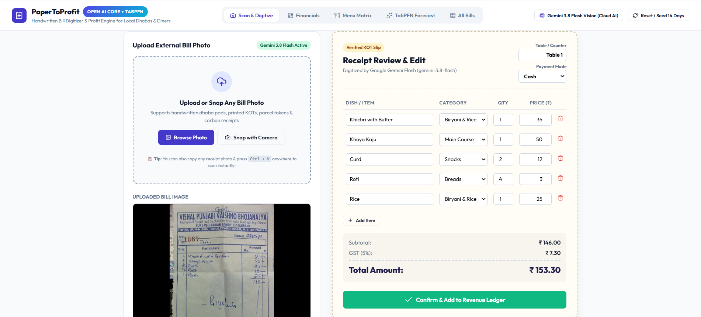
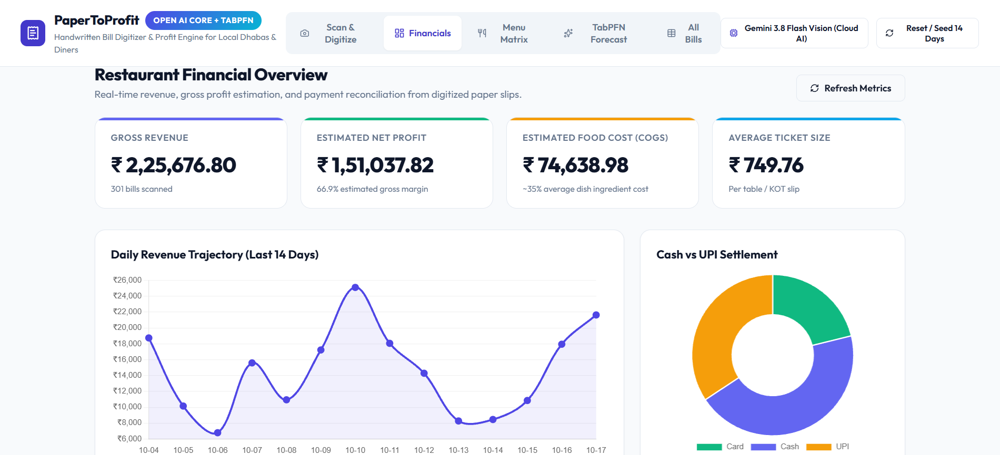
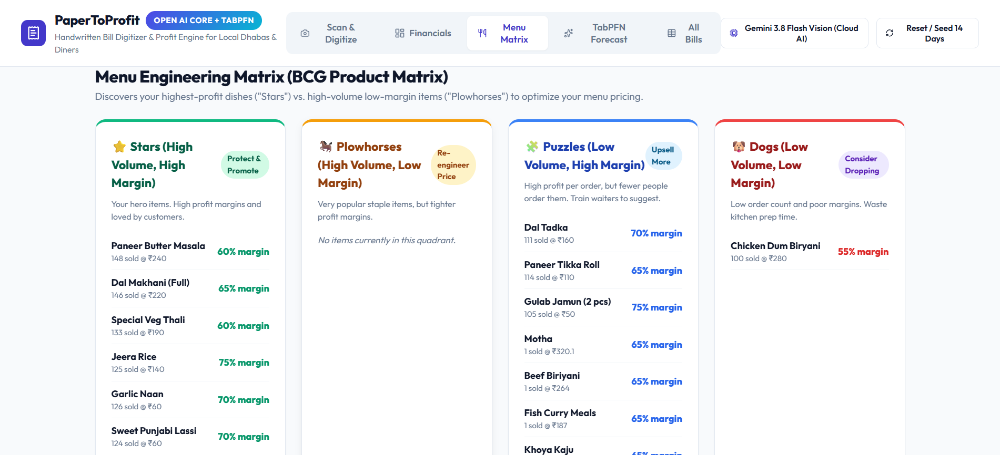
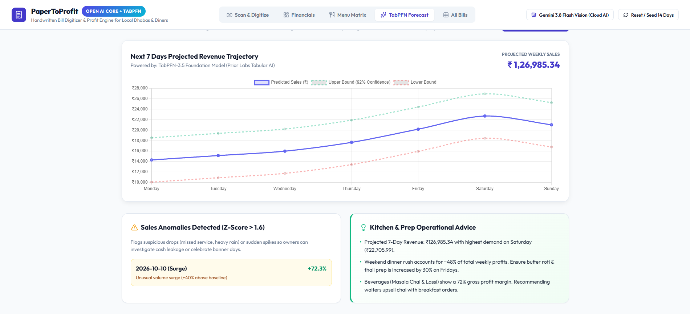
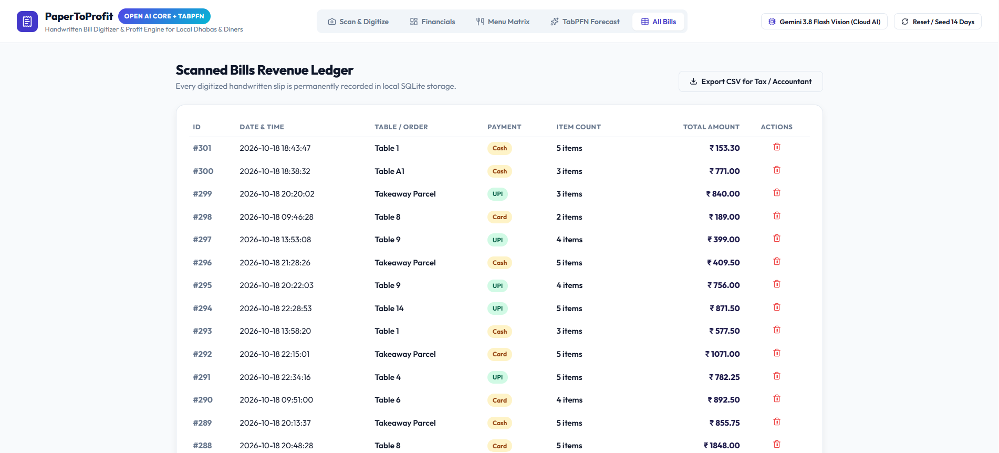
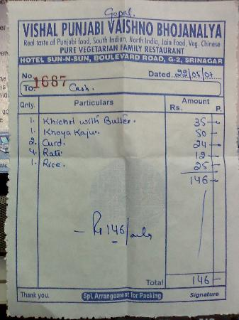

# 🧾 PaperToProfit (KOT-Lens)

[](LICENSE)
[](https://python.org)
[](https://fastapi.tiangolo.com)
[](https://ai.google.dev)
[](https://github.com/prior-labs/TabPFN)
[](https://papertoprofit.onrender.com)

> **Turn handwritten paper dhaba bills and KOT slips into real-time revenue, gross profit, and predictive sales analytics using open-weight AI and TabPFN.**
> 
> 🌐 **Try the Live App:** [https://papertoprofit.onrender.com](https://papertoprofit.onrender.com)

---


## 📌 The Problem
Neighborhood dhabas, local diners, and street tea stalls across the globe operate entirely on **handwritten carbon paper pads (KOTs) and notepad slips**. 

Because commercial POS systems (like Toast or Petpooja) cost **$60–$180/month** and require manual keypad entry during rush service, owners operate in the dark:
* **No Real-Time Net Margins:** Cash comes in, but true profitability after ingredient costs (~35% COGS) is unknown.
* **Cash vs. Digital Mismatch:** Struggle to reconcile physical drawer cash against digital UPI / QR soundbox totals.
* **Blind Menu Pricing:** Unable to determine which dishes are high-margin "Stars" vs. low-margin "Plowhorses".
* **Kitchen Prep Waste:** Over-prepping gravies during slow hours leads to spoilage; under-prepping causes walkouts.

**PaperToProfit** is an open-source, privacy-preserving restaurant intelligence platform built specifically for local food businesses.

---

## ✨ Key Features

* 📸 **Snap, Paste, or Upload:** Upload any bill image, snap directly with your phone camera (`capture="environment"`), or paste screenshots with `Ctrl + V`.
* 🤖 **Multi-Engine Vision Pipeline:**
  * **Google Gemini 3.8 Flash Vision:** High-precision multimodal extraction for messy cursive handwriting, faded carbon paper, and folded slips.
  * **Groq Llama 3.2 Vision:** Free cloud open-weight multimodal inference.
  * **Local Offline RapidOCR:** 2D spatial bounding box clustering running 100% offline on local CPU without any internet or API keys.
* 📋 **1-Tap Tactile Verification:** Interactive receipt-card review screen allowing 1-click quantity, price, and category adjustments.
* 📊 **Live Financials & Rush Heatmaps:** Real-time Gross Revenue, Estimated Net Profit, Average Ticket Size, and hourly sales distribution.
* 🍽️ **Menu Engineering BCG Matrix:** Automatically categorizes dishes into **Stars** (promote), **Plowhorses** (re-price), **Puzzles** (upsell), and **Dogs** (drop).
* 🔮 **TabPFN Predictive Sales Intelligence:** Uses Prior Labs' **TabPFN-3.5** tabular foundation model to project next-week daily revenue trajectory and detect anomalous revenue leaks or surges ($|Z| > 1.6$).
* 🔒 **100% Private & Local:** All business ledger records are stored locally in an embedded SQLite database.

---

## 📺 Video Demo

[](https://youtu.be/6FxF2mufxw0)

▶️ **[Watch the full 2-minute walkthrough on YouTube (https://youtu.be/6FxF2mufxw0)](https://youtu.be/6FxF2mufxw0)**

---

## 📸 Screenshots

| 1. Scan & Digitize Bills | 2. Financial Overview & Rush Heatmaps |
|:---:|:---:|
|  |  |

| 3. Menu Engineering BCG Matrix | 4. TabPFN 7-Day Sales Forecast |
|:---:|:---:|
|  |  |

| 5. Scanned Bills Revenue Ledger | 6. Tested on Real Shopkeeper Bills |
|:---:|:---:|
|  |  |

---

## 🚀 Quick Start

### Option 1: 1-Click Cloud Deploy on Render
Deploy instantly to the cloud with zero configuration using the Render Blueprint button:

[](https://render.com/deploy?repo=https://github.com/SAPNIL-M/PapertoProfit)

### Option 2: 1-Click Launch on Windows
Simply double-click:
```bat
run.bat
```
This automatically starts the server and opens your browser at `http://127.0.0.1:8000`.

### Option 3: Manual Setup

1. **Clone the repository:**
   ```bash
   git clone https://github.com/SAPNIL-M/PapertoProfit.git
   cd papertoprofit
   ```

2. **Create a virtual environment and install dependencies:**
   ```bash
   python -m venv .venv
   # Windows
   .venv\Scripts\activate
   # macOS / Linux
   source .venv/bin/activate

   pip install -r backend/requirements.txt
   pip install rapidocr-onnxruntime
   ```

3. **Configure API Keys (Optional):**
   Create a `.env` file in the root directory:
   ```ini
   # Optional: For state-of-the-art cursive handwriting recognition (Free at aistudio.google.com)
   GEMINI_API_KEY=your_gemini_key_here

   # Optional: For Groq Llama 3.2 Vision (Free at console.groq.com)
   GROQ_API_KEY=your_groq_key_here
   ```
   *(If no API keys are provided, PaperToProfit runs the local RapidOCR 2D spatial clustering engine completely offline).*

4. **Start the application:**
   ```bash
   python -m uvicorn backend.main:app --host 127.0.0.1 --port 8000 --reload
   ```
   Open **`http://127.0.0.1:8000`** in your browser.

---

## 🏗️ Architecture

```text
├── backend/
│   ├── main.py            # FastAPI REST endpoints & static file serving
│   ├── extractor.py       # Vision AI pipeline (Gemini, Groq, 2D Spatial RapidOCR)
│   ├── forecaster.py      # Prior Labs TabPFN-3.5 foundation forecasting engine
│   ├── analytics.py       # Real-time financial KPIs, rush heatmaps & BCG matrix
│   ├── db.py              # Zero-config embedded SQLite persistence
│   └── seed.py            # Realistic 14-day historical dhaba sales seeder
├── static/
│   ├── index.html         # Responsive, mobile-first tactile receipt UI
│   ├── app.js             # Client-side reactivity, Chart.js charts, clipboard paste
│   ├── style.css          # Typography & paper aesthetic styling
│   └── demo_slips/        # Realistic vectorized dhaba and restaurant KOTs
├── docs/                  # Screenshots, sample slips, and challenge submission draft
├── Dockerfile             # Production container definition
├── render.yaml            # Render Blueprint for 1-click cloud deployment
└── run.bat                # 1-click Windows desktop launcher
```

---

## 🏆 Hacktoberfest 2026 Challenge

* Built for the **[Hacktoberfest Open-Source AI Challenge Week 2: Side Hustle](https://dev.to/challenges/hacktoberfest-week2-2026-10-12)**.
* **Entered Tracks:**
  - **Best Use of TabPFN ($200)** — Zero-shot 7-day predictive sales forecasting & anomaly detection.
  - **Best Use of Render ($200)** — Infrastructure-as-code Blueprint and production Dockerfile for 1-click cloud deployment.

---

## 📄 License

Distributed under the **MIT License**. See `LICENSE` for details.
